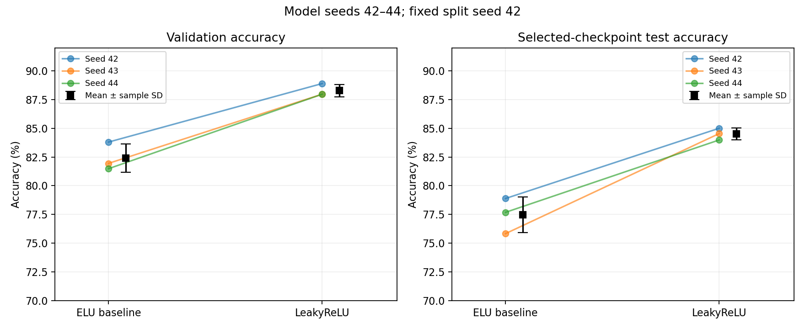

# EEG Signal Classification: EEGNet and DeepConvNet

A from-scratch EEGNet implementation for the course-provided BCI Competition III, IIIb EEG dataset. Experiments compare activation functions, dropout, learning rates, and convolution architectures, followed by runs with three model seeds to assess consistency.

## Main Results

Results below are **mean ± sample standard deviation** across model seeds **42, 43, and 44**, using a fixed data split. Checkpoints are selected by validation accuracy.

| Configuration | Validation Accuracy | Test Accuracy |
| --- | ---: | ---: |
| EEGNet, ELU baseline | 82.41% ± 1.22% | 77.47% ± 1.54% |
| **EEGNet, LeakyReLU (selected configuration)** | **88.27% ± 0.53%** | **84.51% ± 0.51%** |
| DeepConvNet, selected ELU | 86.57% ± 0.46% | 82.96% ± 0.76% |

LeakyReLU outperformed the baseline on validation and test accuracy for all three paired seeds, improving mean test accuracy by **7.04 percentage points**. All model seeds share one data split, so these runs are not cross-validation. Seed 42 was used for tuning and is also included in the reported means.

Selected configuration: LeakyReLU slope **0.01**, dropout **0.25**, Adam learning rate **0.01**, weight decay **0.001**, batch size **64**, and **150 epochs**, with **17,874** trainable parameters.

- **Selected checkpoint example:** seed 42, validation-selected epoch 131; Train **98.73%**, Validation **88.89%**, Test **85.00%**.
- **Highest monitored EEGNet test accuracy: 86.11%** (seed 44, epoch 123). This is a maximum over repeated test evaluations, reported separately from validation-selected checkpoint scores and the three-seed means.



## Where to Start

- [Experiment results and discussion](results/README.md): 17 full runs, combination comparisons, three model seeds, loss curves, and confusion matrices.
- [Model and data processing](docs/IMPLEMENTATION.md): EEGNet architecture, activation functions, depthwise/separable convolution, and evaluation protocol.
- [Reproduction guide](docs/REPRODUCIBILITY.md): dataset setup, training, Colab, checkpoint verification, and figure regeneration.
- [Full curves for the selected model](results/figures/selected_curves.png) | [Confusion matrices](results/figures/confusion_matrices.png) | [All loss curves](results/figures/all_loss_curves.png).

## Project Structure

```text
lab2_EEG_classification/   EEGNet, data processing, and training entry point
configs/                  Baseline, selected, one-factor, and combination settings
notebooks/Colab.ipynb      Single Colab workflow
scripts/                  Batch training, verification, analysis, and Colab packaging
results/                  Experiment tables, figures, and per-epoch results
  runs/                   Settings, metrics, summaries, and verification for 17 EEGNet runs
  bonus/                  Five DeepConvNet runs, comparison tables, and figures
  figures/                Loss/accuracy curves, seed comparisons, and confusion matrices
  README.md               Consolidated experiment analysis
  experiments.csv         Complete experiment table
  loss_comparison.csv     Loss comparison across experiments
  seed_summary.csv        Means and standard deviations across three seeds
docs/                     Implementation and reproduction guides
tests/                    Data, model, training, and result consistency tests
```

Datasets, model weights, original result archives, and local backups are excluded from Git. The root-level `local_archive/` directory stores local archives, while `outputs/` holds new experiment outputs; both are excluded by `.gitignore`. Reviewed results and figures in `results/` are included in version control.

## Quick Start

```bash
python -m venv .venv
source .venv/bin/activate
python -m pip install -r requirements.txt
python -m unittest discover -s tests -v
```

Tests use small synthetic datasets or published result snapshots and do not require the full dataset. To train, place the four course-provided NPZ files in [`lab2_EEG_classification/data/`](lab2_EEG_classification/data/README.md), then run:

```bash
python lab2_EEG_classification/main.py --config configs/selected.json --device cuda
```

Train the baseline and selected configuration with three model seeds:

```bash
python scripts/run_experiments.py --configs configs/baseline.json configs/selected.json --seeds 42 43 44 --device cuda
```

For Colab, run `python scripts/package_colab.py`, then open [`notebooks/Colab.ipynb`](notebooks/Colab.ipynb).

Regenerate figures and tables from the published metrics and summaries without training or the dataset:

```bash
python scripts/analyze_results.py
```

## DeepConvNet Bonus

The four-block DeepConvNet implementation and all five GPU experiments are complete and independently verified. A three-candidate search selected ELU with learning rate 0.001 by validation accuracy, followed by repetitions with model seeds 43 and 44. Existing EEGNet results were reused.

DeepConvNet achieved **82.96% ± 0.76%** selected-checkpoint test accuracy across three seeds, compared with **77.47% ± 1.54%** for the original ELU EEGNet baseline and **84.51% ± 0.51%** for selected LeakyReLU EEGNet. It uses **266,352 parameters**, about 14.9 times the EEGNet parameter count. The selected LeakyReLU EEGNet remains the stronger configuration in this comparison.

- [Bonus results, full curves, and confusion matrices](results/bonus/README.md)
- [DeepConvNet architecture and experiment protocol](docs/BONUS.md)
- [EEGNet/DeepConvNet comparison figure](results/bonus/figures/eegnet_deepconvnet_comparison.png)

To regenerate bonus figures from published results, run `python scripts/bonus_results.py results/bonus`. To intentionally rerun training on Colab, use notebook sections **1–2**, then **6**.
