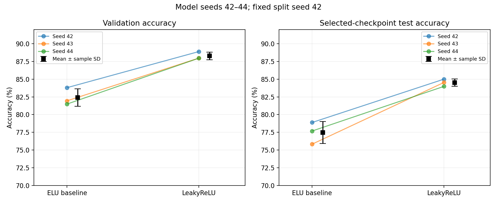
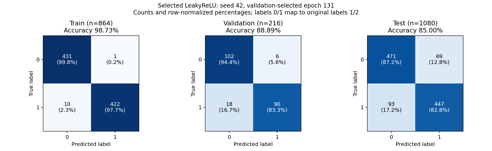

# 實驗結果與分析

本頁統整 17 組完整 150-epoch 實驗：原始 baseline、九組單因子比較、三組 LeakyReLU 組合，以及 baseline／LeakyReLU 各兩組額外 seeds。完整訓練在 Colab Tesla T4 執行；所有原始 run 的 checkpoint、source/data hashes、切分、metrics 與圖表皆已獨立驗證。

## 單因子比較（model seed 42）

每次只修改 baseline 的一個設定；其他條件與資料切分保持不變。下表依 validation accuracy 排序。所有 Accuracy 單位為百分比。

| 實驗 | Selected epoch | Validation | Selected test | Monitored test max |
| --- | ---: | ---: | ---: | ---: |
| [leaky_relu_seed42](runs/leaky_relu_seed42/metrics.csv) | 131 | 88.89 | 85.00 | 85.19 |
| [lr_0001_seed42](runs/lr_0001_seed42/metrics.csv) | 70 | 87.04 | 79.63 | 80.83 |
| [relu_seed42](runs/relu_seed42/metrics.csv) | 146 | 86.57 | 81.39 | 83.33 |
| [lr_0005_seed42](runs/lr_0005_seed42/metrics.csv) | 104 | 85.65 | 80.46 | 81.20 |
| [dropout_05_seed42](runs/dropout_05_seed42/metrics.csv) | 145 | 84.72 | 79.54 | 80.28 |
| [elu_baseline_seed42](runs/elu_baseline_seed42/metrics.csv) | 132 | 83.80 | 78.89 | 80.37 |
| [elu_alpha_05_seed42](runs/elu_alpha_05_seed42/metrics.csv) | 52 | 82.87 | 81.39 | 81.57 |
| [dropout_00_seed42](runs/dropout_00_seed42/metrics.csv) | 42 | 81.48 | 76.94 | 80.56 |
| [depthwise_separable_seed42](runs/depthwise_separable_seed42/metrics.csv) | 130 | 76.39 | 72.50 | 74.63 |
| [elu_alpha_20_seed42](runs/elu_alpha_20_seed42/metrics.csv) | 104 | 75.00 | 72.31 | 73.80 |

LeakyReLU 在本次單因子比較中得到最高 validation accuracy。較低 learning rate 和 ReLU 也改善 validation；移除 dropout 則變差。ELU alpha 0.5 雖有較高 test score，但 validation 低於 baseline，因此不因 test 結果而提升其優先序。True depthwise-separable block 將參數從 17,874 降至 4,018，但本次設定的 validation accuracy 降至 76.39%；這是本次大小／效能的取捨，而不是對所有 separable convolution 的普遍結論。

## 組合比較與設定選擇

用 seed 42 比較原本 LeakyReLU 與三個組合，依 validation-selected checkpoint 的 validation accuracy 選擇；相同分數優先保留 reference。決策先於 seed repetitions 完成，test 不參與選擇。

| LeakyReLU 設定 | Validation | Selected test |
| --- | ---: | ---: |
| LR 0.01、dropout 0.25（reference） | 88.89 | 85.00 |
| LR 0.001 | 87.96 | 84.17 |
| Dropout 0.5 | 87.04 | 85.09 |
| LR 0.005 | 87.04 | 83.33 |

三個組合都沒有超過 reference 的 validation accuracy，因此保留 LeakyReLU、LR 0.01、dropout 0.25。Dropout 0.5 的 test accuracy 略高，但不以 test 改變選模決策。

## 三個 model seeds

| 設定 | Seed | Selected epoch | Validation | Selected test |
| --- | ---: | ---: | ---: | ---: |
| elu_baseline | 42 | 132 | 83.80 | 78.89 |
| elu_baseline | 43 | 105 | 81.94 | 75.83 |
| elu_baseline | 44 | 123 | 81.48 | 77.69 |
| leaky_relu | 42 | 131 | 88.89 | 85.00 |
| leaky_relu | 43 | 146 | 87.96 | 84.54 |
| leaky_relu | 44 | 121 | 87.96 | 83.98 |

| 設定 | Validation mean ± sample SD | Selected test mean ± sample SD |
| --- | ---: | ---: |
| ELU baseline | 82.41 ± 1.22 | 77.47 ± 1.54 |
| LeakyReLU | **88.27 ± 0.53** | **84.51 ± 0.51** |

LeakyReLU 在三個 paired seeds 的 validation 與 test accuracy 都優於 baseline，平均 test accuracy 增加 **7.04 個百分點**。樣本標準差使用 ddof=1。這是在同一 split 下的初始化／訓練變動，不是 cross-validation。Seed 42 曾參與調參且納入平均，因此結果不是完全獨立的調參後測試，也不足以宣稱普遍優勢或統計顯著性。

## 曲線、Loss 與 confusion matrix

- [選定模型的完整 Train／Validation／Test 曲線](figures/selected_curves.png)：seed 42、150 epochs、validation-selected epoch 131；另有 [seed 43](figures/selected_seed43_curves.png)／[seed 44](figures/selected_seed44_curves.png)。
- [全部 17 組實驗的 Loss 曲線](figures/all_loss_curves.png)與 [Loss 數值表](loss_comparison.csv)。
- [Confusion matrix](figures/confusion_matrices.png)／[JSON 計數與 checkpoint hash](confusion_matrices.json)。
- [組合比較](figures/combination_comparison.png)／[單因子比較](figures/initial_comparison.png)／[主要候選的 validation 曲線](figures/validation_comparison.png)。

Train 曲線是 training mode 下的逐 batch 最佳化指標；validation/test 曲線使用 evaluation mode。Loss 表中的 selected-checkpoint loss 對三個分割均使用 evaluation mode，因此不能把它與訓練過程的 Train Loss 當成完全相同的量測。

Confusion matrix 使用 **seed 42、epoch 131 的 validation-selected best.pt**。三個分割都在 evaluation mode 重新推論並核對 Loss／Accuracy。Train 864 筆、Validation 216 筆、Test 1,080 筆；Train／Validation／Test Accuracy 分別為 98.73%、88.89%、85.00%。Rows 為 true class，columns 為 predicted class；模型標籤 0/1 對應原始資料標籤 1/2。

| Test true class | Predicted 0 | Predicted 1 |
| --- | ---: | ---: |
| 0 | 471 | 69 |
| 1 | 93 | 447 |

## 解讀限制

- 選定 LeakyReLU checkpoints 的 training accuracy 約 98.6–98.8%，validation 約 88%，仍有 generalization gap。
- 所有實驗最高 monitored test accuracy 為 **86.11%**（LeakyReLU seed 44、epoch 123）；該 run 的 validation-selected epoch 為 121，selected test accuracy 為 83.98%。最大值不能取代選定 checkpoint 或三個 seeds 的平均。
- 目前未達作業 87% performance bracket；未實作 DeepConvNet。
- Runtime／Drive 狀況不同，training duration 僅供記錄，不當成嚴格 benchmark。

## 完整數據與重現

- [experiments.csv](experiments.csv)：17 組實驗的設定與 accuracy／loss。
- [seed_summary.csv](seed_summary.csv)：三個 seeds 的平均與 sample SD。
- [runs/](runs/)：每組的完整 150-epoch metrics、summary、設定、環境與驗證 provenance。目錄名稱已統一，原始 experiment name 留在各 verification.json。
- [重現說明](../docs/REPRODUCIBILITY.md)：公開 metrics 可直接重建總表／圖表；完整 checkpoint inference 需要本機 dataset 與原始權重。
