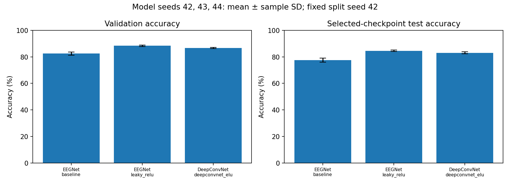
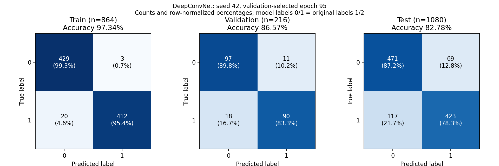

# DeepConvNet Bonus Results

Five 150-epoch GPU runs were completed and independently verified locally. Checks covered source/data hashes, the fixed data split, planned settings, checkpoint predictions, max-norm constraints, all train/validation/test confusion counts, validation-only selection, exported tables, and sample standard deviations. Original GPU verification records and checkpoints are retained privately; sanitized evidence is included in each public run snapshot.

## Candidate Selection

All candidates use model seed 42, split seed 42, dropout 0.5, batch size 64, Adam weight decay 0.001, and 150 epochs. Checkpoints are selected by validation accuracy. The configuration decision is frozen before running seeds 43 and 44; test scores are not used for selection.

| Activation | Learning rate | Selected epoch | Validation accuracy (%) | Selected test accuracy (%) | Monitored test maximum (%) |
| --- | ---: | ---: | ---: | ---: | ---: |
| **ELU** | **0.001** | **95** | **86.57** | **82.78** | 84.63 |
| ELU | 0.0005 | 73 | 84.72 | 81.11 | 83.70 |
| LeakyReLU | 0.001 | 126 | 85.65 | 86.02 | 86.76 |

ELU at learning rate 0.001 has the highest validation accuracy and remains selected. LeakyReLU has a higher test score but lower validation accuracy, so it is not promoted based on the test result. This preserves the declared selection rule.

## Repeated Seeds

The selected DeepConvNet setting uses ELU alpha 1.0, learning rate 0.001, dropout 0.5, convolution max norm 2.0, classifier max norm 0.5, and 266,352 parameters.

| Model seed | Selected epoch | Validation accuracy (%) | Selected test accuracy (%) |
| --- | ---: | ---: | ---: |
| 42 | 95 | 86.57 | 82.78 |
| 43 | 63 | 86.11 | 82.31 |
| 44 | 85 | 87.04 | 83.80 |

All configurations use the same subject/class-stratified 864/216 training/validation split and 1,080 test trials. Split seed is fixed at 42, independently of the model seed. Imputation is fitted on the training partition only; no normalization is added.

## EEGNet Comparison

Results are **mean ± sample standard deviation** across model seeds 42, 43, and 44 (ddof=1). Existing EEGNet runs are reused; no EEGNet retraining was performed for the bonus.

| Model/configuration | Parameters | Validation accuracy (%) | Selected test accuracy (%) |
| --- | ---: | ---: | ---: |
| EEGNet, ELU baseline | 17,874 | 82.41 ± 1.22 | 77.47 ± 1.54 |
| **EEGNet, selected LeakyReLU** | **17,874** | **88.27 ± 0.53** | **84.51 ± 0.51** |
| DeepConvNet, selected ELU | 266,352 | 86.57 ± 0.46 | 82.96 ± 0.76 |

DeepConvNet improves mean selected-checkpoint test accuracy by **5.49 percentage points** over the original ELU EEGNet baseline, but trails the selected LeakyReLU EEGNet by **1.54 points**. It also uses about **14.9 times** as many parameters. The selected EEGNet remains the stronger configuration in these experiments; a larger model did not automatically yield a better result.



These are practical configuration comparisons, not architecture-only comparisons: DeepConvNet uses a different tuned learning rate, dropout, and max-norm regularization. Three model seeds on one fixed split are not cross-validation or a measure of uncertainty across datasets. Seed 42 participated in tuning and contributes to the means. The observed differences do not establish statistical significance or universal model superiority.

## Curves and Confusion Matrices

- Full 150-epoch train/validation/test loss and accuracy: [seed 42](figures/deepconvnet_seed42_curves.png), [seed 43](figures/deepconvnet_seed43_curves.png), [seed 44](figures/deepconvnet_seed44_curves.png).
- [Train/validation/test confusion matrices](figures/deepconvnet_confusion_matrices.png): selected ELU seed-42 checkpoint, epoch 95.
- [Loss comparison](figures/loss_comparison.png): all five bonus runs plus the selected EEGNet seed-42 run.
- Numeric confusion counts for every checkpoint are included in `runs/*/confusion_matrices.json`.

The confusion matrix rows are true labels and columns are predicted labels; model labels 0/1 map to original dataset labels 1/2. Curves record training-mode train metrics, while selected-checkpoint scores and confusion matrices use evaluation mode on all partitions.



The highest monitored DeepConvNet test accuracy is **86.76%**, from the LeakyReLU candidate at epoch 130. This is a maximum over repeated test evaluations, separate from its selected-checkpoint score and the selected ELU model's seed means. It does not reach the assignment's 87% performance bracket. Timing comparisons are not strict benchmarks because plotting/checkpoint I/O and runtime conditions differ.

## Files and Reproduction

- [comparison.csv](comparison.csv) / [comparison.json](comparison.json): all five runs, including separately labeled selected test scores and monitored maxima.
- [seed_summary.csv](seed_summary.csv): three-seed comparison with both EEGNet configurations.
- [selection.json](selection.json): frozen validation-only decision and selected configuration.
- [verification.json](verification.json): summary of independent verification.
- `runs/<experiment>/`: portable configuration, complete metrics, summary, environment, verification provenance, and confusion counts. No EEG signals, model weights, or machine-specific absolute paths are published.
- [Architecture and training protocol](../../docs/BONUS.md).

Regenerate figures from the public snapshots without training, dataset files, or weights:

```bash
python scripts/bonus_results.py results/bonus
```

Full inference verification requires the original private runs and dataset; see the [reproduction guide](../../docs/REPRODUCIBILITY.md).
